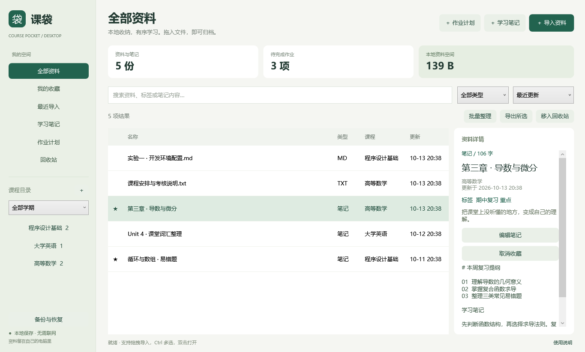

# university-study · 大学生学习工具

面向大学生日常学习的工具仓库。目前提供 **课袋电脑版（CoursePocket Desktop）1.1.0**：在 Windows 上按课程整理资料、记录笔记和管理作业的本地应用，无需账号、联网或启动服务器。

> 当前仓库提供可执行程序、使用说明、界面截图和测试结果记录，尚未包含源码、构建脚本或可复跑的测试脚本。

## 界面预览



截图使用示例资料，不会将示例写入用户资料库。

## 主要功能

| 功能 | 说明 |
| --- | --- |
| 学期与课程管理 | 按学期筛选课程，记录教师和备注，右键编辑课程 |
| 资料导入与去重 | 支持多文件选择和拖入实际文件；复制原件，在同一课程内按内容去重；重新导入原件可修复缺失或损坏的副本 |
| 批量整理 | Ctrl / Shift 多选后移动课程、追加标签、加入收藏 |
| 搜索、筛选与排序 | 搜索文件名、课程、标签、备注和笔记正文；按类型过滤，按更新时间、导入时间、名称、大小排序；查看近 7 天导入资料 |
| 预览与笔记 | 侧栏预览图片、UTF-8 文本；创建、编辑、保存和导出 Markdown 文本笔记 |
| 作业计划 | 记录截止日期、说明和完成状态，显示逾期和剩余天数 |
| 回收站与导出 | 文件和笔记可恢复或彻底删除；批量导出遇到同名文件自动编号；作业删除不可撤销 |
| 备份与完整性检查 | ZIP 备份涵盖课程、文件、笔记、标签、收藏、作业和回收站；检查副本缺失或损坏等情况 |

1.1.0 重点改进了备份内容校验、损坏副本修复、删除失败回滚、异常索引恢复、部分导出结果提示、未保存笔记保护和作业截止日期的跨时区保存。详细记录见 [审查报告](CoursePocketDesktop-v1.1.0/REVIEW.md)。

## 下载与运行

### 运行环境

- Windows 10 / 11。
- .NET Framework 4.7.2 或更新版本；仓库内配置文件声明目标版本为 4.7.2。
- PDF、Office 等文件的外部打开需要安装对应阅读软件。

### 启动步骤

1. 在仓库首页选择 **Code → Download ZIP**，下载并完整解压到普通文件夹。
2. 进入 `CoursePocketDesktop-v1.1.0`，双击 `CoursePocket.exe`。
3. 保留同目录的 `CoursePocket.exe.config`；运行无需管理员权限。

也可使用 Git 下载：

```powershell
git clone https://github.com/Kestode/university-study.git
cd university-study\CoursePocketDesktop-v1.1.0
.\CoursePocket.exe
```

当前尚无 GitHub Release，请通过仓库 ZIP 下载。应用未进行商业代码签名；不同电脑、显示缩放和第三方阅读器的兼容性尚未全面验证。

### 第一次使用

1. 点击左侧“课程目录”旁的 **＋**，新建课程。
2. 选中课程，点击 **导入资料**，或把文件拖到资料列表。
3. 选中资料，在右侧查看信息和预览；双击打开文件或编辑笔记。
4. 使用 Ctrl / Shift 多选，再进行批量整理；Ctrl+F 聚焦搜索，Delete 请求删除确认。
5. 在作业计划中记录截止日期；定期通过“备份与恢复”把完整 ZIP 备份保存到另一磁盘或设备。

**导入仅复制文件，不移动或修改原件。** 外部阅读器打开的是只读副本，修改不会同步回资料库。需要编辑附件时，请先导出，修改后重新导入。应用只允许白名单文档类型直接打开，其他格式需导出后自行选择软件；不会从应用内直接运行可执行文件或脚本。

## 数据保存、备份与恢复

资料库保存在当前 Windows 用户的 `%LOCALAPPDATA%\CoursePocketDesktop`，与程序目录分开：

| 数据项 | 用途 |
| --- | --- |
| `library.json` | 主索引 |
| `library.json.previous` | 上一次索引，供异常恢复辅助使用 |
| `files/` | 导入文件的独立副本 |
| `delete-staging/` | 未完成删除事务的暂存目录 |
| `open-copies/` | 外部阅读器打开的只读副本 |

- 删除程序目录不会删除资料库；删除上述数据目录会删除资料库。不要手动修改索引或文件 ID。
- 上次索引不包含完整附件，也可能缺少最近改动，不能代替完整 ZIP 备份。
- 恢复采用**合并**方式：保留现有资料，同名且同学期的课程合并；重复恢复会新增资料和作业副本。
- 恢复会校验路径、长度与 SHA-256 等信息；完整性校验不能证明备份来源可信。
- 备份是未加密的普通 ZIP。文档给出的上限为 50 GB 文件总量、100000 份资料、32 MB 元数据，尚未完成该规模的压力测试。
- 主索引损坏时可尝试应用提供的上次索引恢复；若仍失败，先关闭应用并复制保存整个数据目录，再参照 [恢复说明](CoursePocketDesktop-v1.1.0/REVIEW.md#升级与恢复) 处理。

## 仓库目录

以下为当前仓库文件，不是源码目录：

| 路径 | 内容 |
| --- | --- |
| `README.md` | 项目入口与快速开始 |
| `CoursePocketDesktop-v1.1.0/CoursePocket.exe` | Windows 桌面程序 |
| `CoursePocketDesktop-v1.1.0/CoursePocket.exe.config` | .NET 运行时及 DPI 配置 |
| `CoursePocketDesktop-v1.1.0/README.md` | 版本详细使用说明 |
| `CoursePocketDesktop-v1.1.0/REVIEW.md` | 缺陷修复、审查方法与残余限制 |
| `CoursePocketDesktop-v1.1.0/界面预览-示例数据.png` | 示例界面截图 |
| `CoursePocketDesktop-v1.1.0/test-results.txt` | 16 项功能回归检查结果 |
| `CoursePocketDesktop-v1.1.0/audit-before.txt` | 修复前的问题复现记录 |
| `CoursePocketDesktop-v1.1.0/audit-after.txt` | 修复后 21 项对抗性检查结果 |
| `CoursePocketDesktop-v1.1.0/preview.png.ui-tests.txt` | 10 项 WPF 控件检查结果 |

## 当前限制

- 本仓库未提供安卓客户端；版本说明提到的安卓首版与电脑版没有自动同步，备份格式也不同，跨端需导出实际文件再导入。
- 不支持 PDF、Word、PPT 等附件正文全文检索或 OCR；Markdown 按文本编辑和预览，不做富文本渲染。
- 不递归导入文件夹；图片超过 30 MB、文本超过 4 MB 时不在侧栏预览。文本预览最多 10000 字符，笔记预览最多 12000 字符，编辑笔记时可查看全文。
- 应用关闭后不会发送作业通知；未保存笔记没有断电或强制退出后的自动草稿恢复。
- 不提供云同步、加密备份或杀毒；敏感文件操作不支持符号链接和目录联接。

## 验证与开发状态

仓库现有记录显示：16 项功能回归、21 项对抗性检查和 10 项 WPF 控件检查通过，合计 47 项。这些是随版本提交的历史结果，本 README 整理未重新运行程序或测试。

测试未全面覆盖实际拖拽、系统文件选择框、第三方阅读器、多显示器缩放、真实断电或大规模资料库。详细证据与边界见 [REVIEW.md](CoursePocketDesktop-v1.1.0/REVIEW.md)。

版本说明提及 `build.ps1`、`verify.ps1` 和 `legacy-backup.zip`，但当前仓库均未包含，也没有源码工程，因此目前无法仅凭此仓库重新构建或复跑测试。

## 反馈与贡献

遇到问题可提交 [Issue](https://github.com/Kestode/university-study/issues)，附上 Windows 版本、应用版本、复现步骤、预期与实际结果，以及去除私人资料后的截图或错误信息。文档改进可提交 Pull Request。

当前仓库未声明许可证；使用、修改或再分发的授权范围需由维护者补充明确。

## 优先补齐的 3 个项目基础项

1. **源码与可复现构建/测试入口**：补齐源码工程、`build.ps1`、`verify.ps1` 和必要的合成测试数据，说明工具链与命令，并加入 Windows CI。让现有测试结果可复核、问题可修复。
2. **明确许可证**：由维护者选择并添加 `LICENSE`，在 README 标明适用范围，明确源码与二进制的使用、修改和分发权限。
3. **规范版本发布**：为 1.1.0 建立版本标签与 GitHub Release，提供含 EXE 和配置文件的完整 ZIP、SHA-256 校验值及更新日志，逐步将发布产物与源码分开管理。
